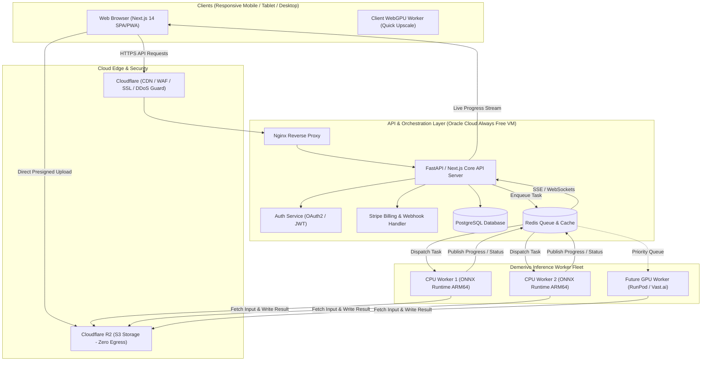

# Demerivo PixelFix — Phase 0: Repository Audit Report
**Target Project:** Demerivo PixelFix (Commercial Subscription-based AI Photo Enhancement SaaS)  
**Base Repository:** NextGenUp v1.3.0 (`riponcm/nextgenUp`)  
**Local Codebase Path:** `D:\Projects\demerivo-pixelfix`  
**Audit Conducted By:** Senior Software Architect, AI/ML Engineer, Full-Stack Developer & DevOps Engineer  
**Date:** November 2026  
**Status:** Complete (Read-Only Phase 0)

---

## 1. Executive Summary

NextGenUp is an open-source, desktop-first, and self-hosted AI photo, video, and audio enhancement suite created by Matily under the permissive MIT license. The application provides an extensive suite of media enhancement capabilities: super-resolution image and video upscaling, background removal, object inpainting (magic eraser), photo denoising, deblurring, old photo colorization, face restoration, vocal/instrumental separation, speech denoising, automated mastering, and video utility processing.

### Key Audit Findings

1. **AI Processing Engine Strengths:**
   - **Unified ONNX Runtime Pipeline:** Unlike many AI projects that rely on PyTorch and CUDA runtime dependencies, NextGenUp runs its primary server-side inference through **ONNX Runtime (CPUExecutionProvider)**. Models have been traced and exported to ONNX format with tiled/windowed inference (128px tiles for Real-ESRGAN, 512px windows for restoration models).
   - **Client-Side WebGPU Offloading:** The frontend leverages `onnxruntime-web` (WebGPU with WASM fallback) for "Quick" upscale and "Pro" video frame processing. In a SaaS model, retaining client-side WebGPU for free or starter tiers represents a monumental infrastructure cost reduction by shifting inference compute to the user's browser.

2. **Core Architectural Gaps for SaaS Conversion:**
   - **Monolithic In-Process Threading:** Background tasks are launched via unmanaged Python `threading.Thread(daemon=True)` inside the Flask process.
   - **Global Inference Lock (`_infer_lock`):** In `ai_engine.py`, `restore_engine.py`, `bg_remove.py`, and `audio_engine.py`, model execution is serialized via a global threading lock. **Only one inference request can execute across the entire server at any instant.** Concurrent multi-user requests will immediately queue or timeout.
   - **No Multi-Tenancy or Authentication:** There is zero concept of user identities, sessions, authentication, tenant file isolation, or authorization.
   - **Local Disk Dependency:** State is stored in an in-memory dictionary `tasks` backed by a local SQLite database (`tasks.db`), and intermediate files are saved to local filesystem folders (`uploads/`, `outputs/`, `frames/`).
   - **Zero Billing or Credit Management:** No database for customer wallets, subscriptions, transactions, or usage accounting.

3. **Infrastructure & Hosting Feasibility (Oracle Cloud Always Free):**
   - **AMD E2.1.Micro (1 OCPU, 1 GB RAM):** **UNFEASIBLE**. Loading a single 224 MB – 340 MB ONNX model into Python alongside NumPy and Pillow will exceed available memory and trigger an Out-Of-Memory (OOM) kernel kill.
   - **Ampere A1 ARM64 (4 OCPUs, 24 GB RAM):** **HIGHLY VIABLE FOR PHASE 1 MVP**. The 24 GB RAM allocation easily accommodates caching all required ONNX models simultaneously, and the 4 Neoverse N1 cores provide adequate throughput for a controlled pilot deployment. Official ARM64 Linux wheels exist for `onnxruntime`, `opencv-python-headless`, `numpy`, and `pillow`.

4. **Critical Legal & Licensing Alert:**
   - **GFPGAN Face Restoration:** While the codebase is MIT, GFPGAN v1.4 was trained on the FFHQ (Flickr-Faces-HQ) dataset, which is governed by a strict **Non-Commercial license (CC BY-NC-SA 4.0)**. Deploying GFPGAN v1.4 in a paid commercial SaaS poses significant intellectual property and legal compliance risks. A commercially cleared face restoration model or alternative architecture (e.g., custom fine-tuned or clean-room checkpoint) must be adopted before monetizing face enhancement.

---

## 2. Existing Repository Structure

### 2.1 Directory Tree

```
D:\Projects\demerivo-pixelfix
├── .github/
│   ├── scripts/
│   │   └── finalize_release.py          # Release packaging automation
│   └── workflows/
│       └── desktop.yml                  # GitHub Actions CI for macOS, Linux, Windows
├── assets/                              # Brand icons, badges, and documentation screenshots
├── desktop-ui/
│   └── index.html                       # Tauri desktop splash screen & local bridge
├── src-tauri/                           # Tauri 2.0 desktop shell (Rust)
│   ├── Cargo.toml                       # Rust crate manifest
│   ├── tauri.conf.json                  # Tauri desktop window & capability configuration
│   └── src/
│       └── main.rs                      # Spawns Python server as sidecar & manages life cycle
├── static/                              # Static web assets
│   ├── css/
│   │   └── style.css                    # Unified dark theme stylesheet (38.7 KB)
│   ├── js/                              # Frontend application logic
│   │   ├── app.js                       # Video processing controller & navigation
│   │   ├── image-app.js                 # Image upscaling, modes, batch & comparison slider
│   │   ├── bg-app.js                    # Background removal controller
│   │   ├── tools-app.js                 # Denoise, deblur, eraser, and colorization
│   │   ├── audio-app.js                 # Stem separation, audio denoise, tag editor
│   │   ├── vtools-app.js                # Video tools (compress, GIF, clean audio)
│   │   ├── storage-app.js               # Local storage cleanup controller
│   │   ├── pro-upscaler.js              # Video frame canvas pipeline
│   │   ├── pro-worker.js                # Client-side ONNX Runtime WebGPU/WASM worker
│   │   └── vendor/
│   │       ├── remaster-lib.js          # Audio DSP mastering bridge
│   │       └── remaster-worker.js       # Client-side audio mastering & tag surgery DSP
│   └── models/                          # Bundled small ONNX models (.gitkeep)
├── templates/
│   └── index.html                       # Monolithic single-page application dashboard (112 KB)
├── tests/
│   ├── __init__.py
│   └── test_userfiles.py                # Unit tests for desktop path and naming helpers
├── ai_engine.py                         # Real-ESRGAN super-resolution engine (ONNX Runtime)
├── app.py                               # Monolithic Flask server & route definitions (70.6 KB)
├── audio_engine.py                      # MDX-Net & DeepFilterNet3 DSP/inference engine
├── bg_remove.py                         # BiRefNet background segmentation engine
├── face_restore.py                      # YuNet face detector + GFPGAN face restoration
├── model_store.py                       # On-demand model download manager & registry
├── paths.py                             # Environment-aware path resolver (dev vs frozen)
├── restore_engine.py                    # SCUNet, NAFNet, DDColor, and LaMa inpainting
├── userfiles.py                         # Desktop save destination & storage cleaner logic
├── video_tools.py                       # FFmpeg two-pass compression, GIF maker, audio remux
├── nextgenup-server.spec                # PyInstaller specification file
├── package.json                         # Tauri CLI npm dev dependencies
├── requirements.txt                     # Minimal Python dependency list
├── setup.sh                             # Bash environment bootstrap script
├── LICENSE                              # MIT License
└── README.md                            # Comprehensive user & developer documentation
```

### 2.2 Component Breakdown

| Component | Technology / Language | Primary Responsibilities |
| :--- | :--- | :--- |
| **Desktop Wrapper** | Rust (Tauri 2.0) | Spawns `nextgenup-server.exe` as a child process; manages native window, auto-updater, and system tray. |
| **Backend Server** | Python 3.10–3.12 (Flask) | Serves SPA; exposes REST APIs; manages task states via SQLite; handles file uploads/downloads. |
| **AI Inference Modules** | Python (`onnxruntime`, `numpy`, `pillow`, `opencv`) | Executes tiled ONNX neural networks on CPU for upscaling, segmentation, inpainting, and restoration. |
| **Media Transcoding** | FFmpeg / FFprobe (Subprocess CLI) | Video scaling (Lanczos+CAS), audio extraction, audio encoding (`f32le`, `aac`), two-pass video compression. |
| **Web Frontend** | Vanilla HTML5, CSS3, ES6 JavaScript | Single-page UI with tab routing, drag-and-drop batch uploaders, interactive before/after sliders, mask brush canvas. |
| **Client Inference** | `onnxruntime-web` (WebGPU / WASM) | Executes client-side Real-ESRGAN inference inside browser Web Workers. |
| **Client Audio DSP** | Web Audio API / Web Worker | Pure DSP LUFS loudness measurement, multi-band compression, and lossless ID3/RIFF tag editing. |

---

## 3. AI Processing Audit & Model Inventory

NextGenUp includes an extensive collection of 10 distinct neural network models and client-side DSP algorithms. The following table provides an exhaustive technical inventory:

### 3.1 Model Inventory Table

| Feature | Model Name | Format & Size | Download Source | Inference Framework | Hardware Support | Input Dimensions / Tiling | Output Format |
| :--- | :--- | :--- | :--- | :--- | :--- | :--- | :--- |
| **Super-Resolution (Server)** | `realesr-general-x4v3` | ONNX (~5.0 MB) | HuggingFace (`OwlMaster/AllFilesRope`) | ONNX Runtime (`CPUExecutionProvider`) | CPU (Server); WebGPU / WASM (Client) | HxWx3 float32 [0,1]; Tiled 128x128 with 12px padding | 4x or 2x RGB PNG (Capped at 8K) |
| **Background Removal** | `BiRefNet_lite` | ONNX (~224.0 MB) | HuggingFace (`onnx-community/BiRefNet_lite`) | ONNX Runtime (`CPUExecutionProvider`) | CPU (Server) | 1024x1024 RGB, ImageNet normalized | Alpha mask -> 32-bit RGBA PNG or RGB with hex fill |
| **Face Detection** | `face_detection_yunet` (2023mar) | ONNX (~390 KB) | OpenCV Zoo (GitHub) | OpenCV DNN (`cv2.FaceDetectorYN`) | CPU (Server) | Downscaled RGB (max 1000px) | 5 landmark coordinates (eyes, nose, mouth corners) |
| **Face Restoration** | `GFPGANv1.4` | ONNX (~340.0 MB) | HuggingFace (`OwlMaster/AllFilesRope`) | ONNX Runtime (`CPUExecutionProvider`) | CPU (Server) | 512x512 aligned RGB crop (normalized -1 to 1) | 512x512 restored crop; inverse-warped with Gaussian feather |
| **Denoising** | `SCUNet` (`scunet_color_real_psnr`) | ONNX + Data (~76.9 MB) | HuggingFace (`Heliosoph/scunet-onnx`) | ONNX Runtime (`CPUExecutionProvider`) | CPU (Server) | HxWx3 float32 [0,1]; Tiled 512x512 windows, 32px overlap | Denoised RGB PNG |
| **Deblurring** | `NAFNet-GoPro` (`deblurring_nafnet`) | ONNX (~91.7 MB) | HuggingFace (`opencv/deblurring_nafnet`) | ONNX Runtime (`CPUExecutionProvider`) | CPU (Server) | Fixed 512x512 windows with 32px overlap (attention-bound) | Deblurred RGB PNG |
| **Photo Colorization** | `DDColor-tiny-fp16` | ONNX (~135.4 MB) | HuggingFace (`edgetools/ddcolor`) | ONNX Runtime (`CPUExecutionProvider`) | CPU (Server) | 512x512 Grayscale reconstructed in CIELAB | Predicted `ab` chromaticity composited onto full-res `L` |
| **Object Inpainting (Eraser)** | `LaMa` (`lama_fp32`) | ONNX (~208.0 MB) | HuggingFace (`Carve/LaMa-ONNX`) | ONNX Runtime (`CPUExecutionProvider`) | CPU (Server) | 512x512 RGB image + 512x512 binary mask | Inpainted crop composited into full-res image with blur mask |
| **Audio Stem Separation** | `MDX-Net Kim Vocal 2` | ONNX (~66.8 MB) | HuggingFace (`seanghay/uvr_models`) | ONNX Runtime (`CPUExecutionProvider`) | CPU (Server) | 44.1 kHz stereo audio STFT (NFFT 7680, hop 1024) | Isolated Vocals (`.wav`) & Instrumental (`.wav`) |
| **Speech Noise Removal** | `DeepFilterNet3` (Encoder + 2 Decoders) | ONNX Archive (~8.0 MB) | GitHub (`Rikorose/DeepFilterNet`) | ONNX Runtime (`CPUExecutionProvider`) | CPU (Server) | 48 kHz mono audio; ERB filterbank + complex STFT | Denoised 48 kHz speech (`.wav`) |
| **Audio Mastering** | ReMaster DSP Core | JavaScript Worker (~26.6 KB) | Local bundled asset | Web Audio API / Native JS DSP | Browser Client CPU | Raw Float32Array PCM Audio | Mastered 24-bit WAV |

### 3.2 Deep-Dive Pipeline Analysis

#### A. Image Upscaling (`ai_engine.py`)
- **Tiling Mechanics:** Uses an overlapping tile scheme to keep memory footprint bounded:
  $$\text{Tile Size} = 128 \times 128, \quad \text{Padding} = 12 \text{ px}$$
- **Scale Options:**
  - 4x: Native Real-ESRGAN output.
  - 2x: Upscales to 4x using the ONNX model, then downsamples using Pillow's `Image.LANCZOS`.
  - Enhance: Upscales 4x, applies optional face restoration, then resizes back to the exact original input dimensions.
- **Resolution Ceiling:** Enforces an explicit 8K cap ($\max(\text{width}, \text{height}) \le 7680\text{ px}$).

#### B. Face Restoration Pipeline (`face_restore.py`)
1. An input BGR image is dynamically downscaled so its longest side is $\le 1000\text{ px}$ for fast, stable landmark detection via YuNet.
2. For each detected face, 5 landmarks are normalized and aligned to an FFHQ 512x512 coordinate template using an affine partial 2D transform (`cv2.estimateAffinePartial2D` with LMedS).
3. The aligned 512x512 crop is normalized to $[-1, 1]$ and evaluated with `GFPGANv1.4.onnx`.
4. An inverse affine matrix maps the restored crop back to the original image coordinate space.
5. Seam elimination is achieved by generating a 512x512 mask, eroding by 32 px, applying a 41x41 Gaussian blur, and warping the feathered alpha mask over the target region.

#### C. Background Removal (`bg_remove.py`)
- Evaluates `BiRefNet_lite` on a 1024x1024 bilinear resized image.
- Normalizes pixel values with ImageNet mean $(0.485, 0.456, 0.406)$ and standard deviation $(0.229, 0.224, 0.225)$.
- Converts output logits to probability values via sigmoid:
  $$P = \frac{1}{1 + e^{-x}}$$
- Resizes the mask back to the original resolution using Lanczos interpolation, applies a 1px Gaussian feather, and applies alpha compositing.

#### D. Photo Restoration & Inpainting (`restore_engine.py`)
- **SCUNet & NAFNet:** Both models are executed across 512x512 windows with 32px padding, extracting a central core of $448 \times 448\text{ px}$ to eliminate border artifacts.
- **DDColor:** Uses CIELAB color space. Luminance ($L$) is extracted and resized to 512x512. The model predicts only the chroma channels ($a, b$). The predicted chroma channels are resized back to original resolution and merged with the untouched full-resolution $L$ channel, ensuring fine photographic edges and textures are never blurred.
- **LaMa Inpainting:** Takes the source image and a user-painted binary brush mask. The mask is expanded using `ImageFilter.MaxFilter(9)` to eliminate edge haloing, processed at 512x512, and composited into the source image with a 3px Gaussian feathered alpha mask.

---

## 4. Backend & API Audit

### 4.1 Architecture & Implementation

The backend is built using Flask 3.0+ in `app.py`. It is structured as a monolithic server script containing 39 endpoints, helper utilities, subprocess orchestration, and persistence logic.

### 4.2 Complete API Route Catalog

| Endpoint | Method | Purpose | Input / Payload | Auth / Security Check |
| :--- | :--- | :--- | :--- | :--- |
| `/` | `GET` | Serves main UI dashboard | None | None |
| `/api/capabilities` | `GET` | Reports available server models | None | None |
| `/api/settings` | `GET`, `POST` | Manages desktop save settings | JSON: `{auto_save, save_dir}` | `_local_only()` (Localhost IP) |
| `/api/saves/recent` | `GET` | Polls recent finished file paths | None | `_local_only()` |
| `/api/jobs/active` | `GET` | Reports active processing count | None | `_local_only()` |
| `/api/storage` | `GET` | Reports disk space of working files | None | `_local_only()` |
| `/api/storage/clean` | `POST` | Purges working files | None | `_write_authorized()` (`X-NGU-Token`) |
| `/api/reveal` | `POST` | Opens file in Explorer / Finder | JSON: `{path}` | `_local_only()` |
| `/api/open` | `POST` | Opens URL in default browser | JSON: `{url}` | `_local_only()` |
| `/api/save` | `POST` | Copies result to local folder | JSON: `{task_id, path}` | `_write_authorized()` |
| `/api/save-blob` | `POST` | Writes browser blob to local path | Query param `path`, binary body | `_write_authorized()` |
| `/api/diag` | `GET` | System triage report | None | None |
| `/api/update-check` | `GET` | Checks GitHub releases | None | None |
| `/api/upload` | `POST` | Video file upload | Multipart form: `video` | Extension & magic check |
| `/api/upscale/basic` | `POST` | Starts FFmpeg video upscale | JSON: `{task_id, scale}` | None |
| `/api/progress/<task_id>` | `GET` | SSE progress stream | URL param | None |
| `/api/cancel/<task_id>` | `POST` | Cancels video or audio task | URL param | None |
| `/api/download/<task_id>` | `GET` | Downloads finished video file | URL param | None |
| `/api/pro/start` | `POST` | Prepares folder for WebGPU frames | JSON: `{task_id}` | None |
| `/api/pro/frame/<id>/<num>` | `POST` | Receives client upscaled frame | Binary JPEG payload | None |
| `/api/pro/assemble` | `POST` | Assembles frames via FFmpeg | JSON: `{task_id, fps}` | None |
| `/api/image/upload` | `POST` | Image file upload | Multipart form: `image` | Allowed extensions check |
| `/api/image/upscale` | `POST` | Starts image upscale | JSON: `{task_id, scale, mode}` | None |
| `/api/image/status/<id>` | `GET` | Polls image/tool task status | URL param | None |
| `/api/image/download/<id>` | `GET` | Downloads finished image | URL param | None |
| `/api/image/cancel/<id>` | `POST` | Cancels running image task | URL param | None |
| `/api/models/<key>` | `GET`, `POST` | Model status / trigger download | URL param | None |
| `/api/clean` | `POST` | Starts denoise or deblur task | JSON: `{task_id, mode}` | None |
| `/api/restore` | `POST` | Starts photo restore task | JSON: `{task_id, colorize, ...}` | None |
| `/api/erase` | `POST` | Starts LaMa object inpainting | Multipart: `image`, `mask` | None |
| `/api/bg/model` | `GET`, `POST` | BiRefNet model check / download | None | None |
| `/api/bg/remove` | `POST` | Starts background removal | JSON: `{task_id, background}` | None |
| `/api/audio/upload` | `POST` | Audio file upload | Multipart form: `audio` | None |
| `/api/audio/separate` | `POST` | Starts vocal stem separation | JSON: `{task_id}` | None |
| `/api/audio/denoise` | `POST` | Starts DeepFilterNet3 denoise | JSON: `{task_id}` | None |
| `/api/audio/download/<id>` | `GET` | Downloads processed audio | URL param | None |
| `/api/video/audio` | `POST` | Audio manipulation in video | JSON: `{task_id, mode}` | None |
| `/api/video/compress` | `POST` | Starts two-pass video compression | JSON: `{task_id, target_mb}` | None |
| `/api/video/gif` | `POST` | Starts palette-optimized GIF | JSON: `{task_id, fps, width}` | None |
| `/api/file/<task_id>` | `GET` | Generic task file downloader | URL param | None |
| `/api/zip` | `POST` | Creates ZIP archive of task IDs | JSON: `{task_ids}` | None |
| `/api/zip/<zip_id>` | `GET` | Downloads generated ZIP archive | URL param | None |

### 4.3 Severe Backend Bottlenecks for Cloud SaaS

1. **Global Threading Lock on Inference:**
   ```python
   # ai_engine.py, restore_engine.py, bg_remove.py, audio_engine.py
   _session_lock = threading.Lock()
   _infer_lock = threading.Lock()
   ```
   Every AI model execution is wrapped inside `with _infer_lock:`. Even if 10 users trigger background removal or upscaling on different threads, **they are executed strictly one at a time**. In a web service, this causes request pileups, thread starvation, and gateway timeouts.

2. **In-Memory State with Unindexed SQLite Mirror:**
   Task records are stored in a global Python dict `tasks = {}`. On updates, `save_task(task_id)` executes:
   ```python
   conn.execute('INSERT OR REPLACE INTO tasks VALUES (?, ?, ?)', (task_id, data, time.time()))
   ```
   All metadata is serialized into a single unindexed `TEXT` blob. There is no query capability by user, date range, or processing type.

3. **No Distributed Job Queue:**
   Tasks are executed by spawning raw OS threads (`threading.Thread(target=..., daemon=True)`). If the server crashes or restarts, all active processing jobs die instantly and are marked as failed on reboot.

4. **Zero Authentication and Predictable File Access:**
   Task IDs are generated using UUID prefixes (`img_` + 12 hex characters). File downloads (`/api/image/download/<task_id>`) do not authenticate callers or verify task ownership. Any user who knows or guesses a task ID can download another customer's images.

5. **Local Temporary File Accumulation:**
   Uploaded files and intermediate frame caches are stored directly in local folders (`uploads/`, `outputs/`, `frames/`). An internal timer thread (`_cleanup_loop`) scans directories every hour to delete files older than 24 hours. Under high multi-tenant traffic, local disk I/O contention and disk exhaustion will occur rapidly.

---

## 5. Frontend Audit

### 5.1 Architecture & User Experience

The frontend is implemented as a single-page application rendered via `templates/index.html` (1,742 lines) and styled by `static/css/style.css`. Application state and DOM interactions are divided into 10 modular Vanilla JS controllers in `static/js/`.

```
                    ┌───────────────────────────────┐
                    │     templates/index.html      │
                    │   (Unified Sidebar & Views)   │
                    └───────────────┬───────────────┘
                                    │
    ┌──────────────┬────────────────┼───────────────┬──────────────┐
    │              │                │               │              │
┌───▼────┐   ┌─────▼────┐    ┌──────▼─────┐   ┌─────▼────┐   ┌─────▼────┐
│ image- │   │ bg-app.js│    │tools-app.js│   │ audio-   │   │vtools-   │
│ app.js │   │(BiRefNet)│    │(Denoise,   │   │ app.js   │   │app.js    │
│(Upscale│   └──────────┘    │ Deblur,    │   │(MDX-Net, │   │(Compress,│
│Enhance)│                   │ Colorize,  │   │ DFN3,    │   │ GIF,     │
└───┬────┘                   │ Eraser)    │   │ Mastering│   │ Audio)   │
    │                        └────────────┘   └──────────┘   └──────────┘
    │
┌───▼─────────────────────────────────────┐
│ static/js/pro-worker.js                 │
│ Web Worker (onnxruntime-web / WebGPU)   │
└─────────────────────────────────────────┘
```

### 5.2 Interface Capabilities

1. **Interactive Comparison Divider:**
   Includes a smooth before/after comparison slider enabling users to visually compare original vs. enhanced output side-by-side with zoom and pan capabilities.
2. **Interactive Canvas Mask Eraser:**
   The Magic Eraser tool features an HTML5 canvas brush overlay allowing users to paint arbitrary masks over photobombers or unwanted objects with adjustable brush sizes and full undo/redo stacks.
3. **Audio Waveform & Player:**
   Includes a dual-waveform audio player with loudness-matched A/B comparison for mastering and noise reduction.
4. **Client-Side WebGPU Processing:**
   When running in Chrome or Edge on WebGPU-compatible hardware, "Quick" upscale and "Pro" video upscaling run locally in browser Web Workers without consuming server GPU/CPU cycles.

### 5.3 Mobile & Responsive Gaps

| Aspect | Current Desktop Implementation | Cloud SaaS Requirement (Mobile, Tablet, Desktop) | Severity |
| :--- | :--- | :--- | :--- |
| **Navigation** | Fixed desktop sidebar (`width: 240px`) with permanent vertical layout | Collapsible hamburger menu / bottom tab bar for mobile viewports | High |
| **Touch Events** | Inpainting canvas and before/after slider use mouse events (`mousedown`, `mousemove`) | Unified PointerEvents supporting touch, pinch-to-zoom, and stylus pressure | High |
| **Layout Flexibility** | Fixed two-column layout (`upload-panel` vs `preview-panel`) | Fluid responsive flex/grid adapting from mobile column to desktop split-screen | High |
| **File Selection** | Desktop drag-and-drop zone; native Tauri file picker | Camera capture support (`capture="camera"`), photo library picker, cloud drive import | Medium |
| **Resource Usage** | In-browser WebGPU worker consumes significant device memory | Automatic device capability detection; fall back to server processing on low-power phones | High |

---

## 6. Dependencies & Build Configuration

### 6.1 Python Dependencies (`requirements.txt`)

```ini
flask>=3.0                # Web application framework
onnxruntime>=1.20         # ONNX neural network inference engine (CPU)
pillow>=10.0              # Image reading, manipulation, and format conversion
numpy>=1.26               # Array processing and tensor transformations
certifi>=2024.0           # SSL certificate bundle for secure model downloads
# Optional in setup.sh:
opencv-python-headless>=4.10 # YuNet face detection & affine transformations
pyinstaller               # Bundles Python app into sidecar executable for Tauri
```

### 6.2 Frontend Dependencies

- **ONNX Runtime Web:** `https://cdn.jsdelivr.net/npm/onnxruntime-web@1.21.0/dist/ort.all.min.js` (WebGPU + WASM runtime).
- **JSZip:** `https://cdn.jsdelivr.net/npm/jszip@3.10.1/dist/jszip.min.js` (Client-side ZIP compression for batch downloads).

### 6.3 System Utilities

- **FFmpeg & FFprobe:** Required for all video manipulation, audio transcoding, and audio/video stream probing.

### 6.4 Desktop Build System

- **Tauri 2.0:** Managed via `@tauri-apps/cli` in `package.json` and Rust Cargo dependencies (`tauri`, `tauri-plugin-dialog`, `tauri-plugin-updater`).
- **CI/CD:** `.github/workflows/desktop.yml` compiles multi-platform native installers on GitHub Actions runners (macOS Intel, macOS Apple Silicon, Ubuntu x86_64, Windows MSVC).

---

## 7. Performance & Infrastructure Feasibility Audit

### 7.1 Architecture & Platform Compatibility

| Architecture | Python / Wheel Compatibility | ONNX Runtime Support | Production Viability |
| :--- | :--- | :--- | :--- |
| **x86_64 (Intel/AMD)** | Full native support across all dependencies. | Pre-compiled wheels with AVX2 and AVX-512 vector acceleration. | Excellent. Standard baseline. |
| **ARM64 / aarch64 (Apple Silicon, Ampere)** | Full native support; Python 3.10–3.12 wheels exist for all packages. | Official `onnxruntime` aarch64 Linux wheels on PyPI; accelerated via ARM Neon. | Excellent. Ideal for Oracle Cloud Always Free Ampere A1. |

### 7.2 Oracle Cloud Always Free Tier Evaluation

Oracle Cloud provides two compute architectures under its Always Free tier:

#### Option A: AMD E2.1.Micro Instance
- **Specifications:** 1/8 OCPU (burstable x86_64 core), 1 GB RAM, 480 Mbps network.
- **Feasibility Verdict:** **COMPLETELY INFEASIBLE**.
  - Python base runtime + Flask + NumPy + Pillow: ~120 MB RAM.
  - Loading `birefnet-lite.onnx` (224 MB file): ~650 MB working memory during inference.
  - Loading `GFPGANv1.4.onnx` (340 MB file): ~950 MB working memory.
  - Attempting to load any model immediately causes the Linux kernel OOM (Out Of Memory) killer to terminate the process.

#### Option B: Ampere A1 Compute Instance (ARM64)
- **Specifications:** Up to 4 OCPUs (4 physical Ampere Altra Neoverse N1 cores) and 24 GB RAM (can be provisioned as a single VM or split).
- **Feasibility Verdict:** **HIGHLY FEASIBLE FOR INITIAL PILOT / MVP**.
  - **Memory Headroom (24 GB):** Enables loading all 10 ONNX models into memory permanently, eliminating model reload latency.
  - **Core Distribution (4 Cores):** Supports running 2–3 dedicated inference worker processes in parallel alongside a lightweight reverse proxy and API server.

### 7.3 Performance Estimates & Processing Latency

> [!NOTE]
> The performance metrics below represent engineering estimates based on model parameter counts, ONNX Runtime CPU benchmarks on ARM Neoverse N1 / x86_64 cores, and existing tiling parameters. Mark: **Untested on target production VM until Phase 1 deployment.**

| AI Feature | Processing Resolution | Estimated Inference Time (4 OCPU ARM64) | Estimated Peak RAM (Per Worker) | Bottleneck Factor |
| :--- | :--- | :--- | :--- | :--- |
| **Image Upscale 4x (Real-ESRGAN)** | 1080p -> 4K | 3.5 – 6.0 seconds | ~450 MB | Tiled matrix multiplications across 128px tiles |
| **Image Upscale 4x (Real-ESRGAN)** | 4K -> 8K | 14.0 – 25.0 seconds | ~1.2 GB | Large number of tiles (over 500 tiles) |
| **Background Removal (BiRefNet)** | Any -> 1024x1024 | 1.8 – 3.5 seconds | ~800 MB | High-resolution feature segmentation map |
| **Face Restoration (YuNet + GFPGAN)** | 1 Face (512x512) | 1.2 – 2.0 seconds | ~950 MB | GFPGAN 512x512 generative pass |
| **Photo Deblurring (NAFNet)** | 1080p | 4.0 – 8.0 seconds | ~700 MB | 512px window tiling and self-attention operations |
| **Photo Denoising (SCUNet)** | 1080p | 3.5 – 7.0 seconds | ~650 MB | UNet convolutional passes across windows |
| **Object Inpainting (LaMa)** | 512x512 Mask | 0.8 – 1.8 seconds | ~550 MB | Single 512x512 Fast Fourier Convolution pass |
| **Old Photo Colorization (DDColor)** | 512x512 Chroma | 1.5 – 2.8 seconds | ~600 MB | Color cross-attention feature extraction |
| **Stem Separation (MDX-Net)** | 3-minute Song | 35 – 60 seconds | ~650 MB | Sliding STFT window inference over full track |
| **Speech Denoising (DFN3)** | 1-minute Speech | 4 – 8 seconds | ~250 MB | Streaming ERB / complex STFT filtering |

---

## 8. Licensing & Legal Compliance Audit

Converting an open-source tool into a paid, globally commercialized SaaS requires strict intellectual property hygiene. The following analysis highlights key licensing obligations and critical legal risks:

### 8.1 License Classification Matrix

| Component / Model | Stated License | Commercial Use Permitted? | Distribution / SaaS Caveats |
| :--- | :--- | :--- | :--- |
| **NextGenUp Core Code** | MIT License | **Yes** | Standard attribution required in source documentation. |
| **Real-ESRGAN Model** | BSD 3-Clause | **Yes** | Permissive commercial use. |
| **BiRefNet-lite Model** | MIT License | **Yes** | Permissive commercial use. |
| **SCUNet Model** | Apache 2.0 | **Yes** | Permissive commercial use. |
| **NAFNet Model** | Apache 2.0 | **Yes** | Permissive commercial use. |
| **LaMa Inpainting** | Apache 2.0 | **Yes** | Permissive commercial use. |
| **DDColor Model** | Apache 2.0 | **Yes** | Permissive commercial use. |
| **DeepFilterNet3** | MIT License | **Yes** | Permissive commercial use. |
| **YuNet Face Detector** | Apache 2.0 | **Yes** | Permissive commercial use. |
| **FFmpeg Library** | LGPL v2.1+ / GPL v2+ | **Yes (as SaaS backend)** | Invoking standalone FFmpeg CLI via subprocesses does not trigger copyleft source disclosure requirements under GPLv2/v3 for cloud SaaS (network interaction is not binary distribution). |
| **GFPGAN v1.4 Model** | **Apache 2.0 / CC BY-NC-SA 4.0** | ⚠️ **LEGAL RISK** | Code is Apache 2.0, but pretrained weights were trained on FFHQ, which prohibits commercial exploitation. |

### 8.2 Detailed Analysis of GFPGAN Commercial Risk

> [!WARNING]
> **CRITICAL LEGAL BLOCKER FOR COMMERCIAL MONETIZATION:**
> GFPGAN v1.4 relies on weights trained directly on the **Flickr-Faces-HQ (FFHQ)** dataset created by NVIDIA. FFHQ is explicitly licensed under **Creative Commons Attribution-NonCommercial-ShareAlike 4.0 International (CC BY-NC-SA 4.0)**.
> 
> NVIDIA's license states that the dataset and derivative models trained exclusively upon it cannot be used for commercial advantage or monetary compensation. Offering face restoration powered by standard GFPGAN weights in a subscription tier exposes Demerivo PixelFix to intellectual property claims.
> 
> **Required Phase 1 Remediation:**
> 1. In Phase 1, label face restoration as experimental or restrict it to free non-commercial tier while evaluating commercially cleared models.
> 2. Replace GFPGAN with a commercially permissible model (e.g., fine-tuned models trained exclusively on commercial datasets, RestoreFormer with cleared weights, or clean custom checkpoints).

---

## 9. SaaS Conversion Gap Analysis

The existing NextGenUp codebase is an offline desktop tool with an optional self-hosted local LAN web mode. The following 12 functional pillars must be engineered to transform it into the Demerivo PixelFix subscription platform:

```
┌────────────────────────────────────────────────────────────────────────┐
│                        DEMERIVO PIXELFIX SAAS                          │
├──────────────────────────────────┬─────────────────────────────────────┤
│ 1. Multi-Tenant Identity & Auth  │ NextAuth / OAuth2 / Magic Links     │
│ 2. PostgreSQL Relational Store   │ Users, Subscriptions, Jobs, Credits │
│ 3. Credit Accounting Engine      │ Atomic deduct / refund per feature  │
│ 4. Global Payment Gateway        │ Stripe Checkout, Portal & Webhooks  │
│ 5. S3 Cloud Object Storage       │ Cloudflare R2 presigned URLs        │
│ 6. Distributed Job Queue         │ Redis + Celery / RQ worker pool     │
│ 7. Worker Concurrency Isolation  │ Multi-process workers, no locks     │
│ 8. Future GPU Integration        │ Auto-switching CUDA Execution Prov. │
│ 9. Administrative Dashboard      │ Usage metrics, user refunds, queues │
│ 10. Security & Privacy           │ Ephemeral storage, signed URLs, TLS │
│ 11. Responsive Web App           │ Mobile/tablet touch UI, SSR, PWA    │
│ 12. Monitoring & Observability   │ Sentry, Prometheus, OpenTelemetry   │
└──────────────────────────────────┴─────────────────────────────────────┘
```

### 9.1 Multi-Tenant Identity & Customer Authentication
- **Current State:** Zero authentication. Requests are trusted by default.
- **Required:** OAuth2 authentication (Google, Apple, GitHub) and email passwordless/magic link authentication. User profiles, session management, and encrypted JWT tokens.

### 9.2 Relational Database Schema (PostgreSQL)
- **Current State:** SQLite table (`tasks.db`) with unindexed text blobs.
- **Required:** Production PostgreSQL instance with schema definitions for:
  - `users`: Account identity, email, created timestamp, tier.
  - `subscriptions`: Stripe customer ID, subscription ID, plan tier, status, current period end.
  - `wallets`: Credit balances (free credits, subscription credits, purchased add-on credits).
  - `credit_transactions`: Immutable audit log of every credit deduction, refill, or refund.
  - `jobs`: Multi-tenant job tracking with user ownership, task parameters, duration, compute type, and status.

### 9.3 Subscription Management & Monthly Credit Accounting
- **Current State:** Completely free, unlimited local usage.
- **Required:** Tiered entitlement logic:
  - **Free Tier:** 5 credits/month, standard speed, watermarked or lower resolution limits.
  - **Starter Tier:** 100 credits/month, full resolution up to 4K, batch mode up to 5 items.
  - **Pro Tier:** 500 credits/month, 8K resolution, full restoration suite, priority queue.
  - **Studio Tier:** 2,000 credits/month, bulk processing, maximum priority, API access.
  - Atomic transactions: Check and lock user credits prior to job execution; refund credits automatically if worker fails.

### 9.4 Payment Integration
- **Current State:** None.
- **Required:** Stripe Billing integration:
  - Stripe Checkout for new subscriptions and credit top-up packs.
  - Stripe Customer Portal for self-service cancellation, upgrades, and payment method changes.
  - Webhook processing daemon with idempotency keys to handle `checkout.session.completed`, `invoice.paid`, and `customer.subscription.deleted`.

### 9.5 Cloud Object Storage
- **Current State:** Files saved directly to local disk folders (`uploads/`, `outputs/`).
- **Required:** S3-compatible cloud object store. **Cloudflare R2 is strongly recommended** because it charges **$0 egress fees**, critical for high-resolution image and video downloads. Presigned upload and download URLs to keep heavy media transfer off the API server.

### 9.6 Distributed Background Job Queue
- **Current State:** In-process unmanaged daemon threads (`threading.Thread`).
- **Required:** Distributed broker (Redis) with asynchronous workers (Celery or RQ). Supports job retries, progress reporting, task cancellation, and separate queue priority for Pro/Studio subscribers.

### 9.7 Worker Concurrency Management
- **Current State:** Single process with global `_infer_lock` serializing all requests.
- **Required:** Headless, stateless worker containers. Each worker runs a single process handling one job at a time without thread locks, scaled horizontally according to available CPU cores and queue depth.

### 9.8 Future GPU Worker Integration
- **Current State:** Hardcoded `providers=['CPUExecutionProvider']`.
- **Required:** Abstract worker runtime that inspects hardware environment on startup:
  - If NVIDIA GPU detected: initialize with `CUDAExecutionProvider` or `TensorrtExecutionProvider`.
  - Otherwise: fall back gracefully to `CPUExecutionProvider` with optimized thread pools.

### 9.9 Administrative Dashboard
- **Current State:** Local storage report and update checker.
- **Required:** Admin interface to monitor worker health, queue depth, failed jobs, active users, subscription MRR (Monthly Recurring Revenue), and execute manual credit adjustments or refunds.

### 9.10 Security, Privacy & Data Compliance
- **Current State:** Open endpoints, unauthenticated file access, unencrypted local storage.
- **Required:** 
  - Ephemeral file lifecycle: Automated S3/R2 lifecycle rule purging user uploads and outputs after 24 hours.
  - Strict tenant boundary: Users can only query or download jobs belonging to their authenticated `user_id`.
  - GDPR/CCPA compliance: Account deletion endpoint that purges all user metadata and storage objects.

---

## 10. Recommended Demerivo PixelFix Architecture

To achieve high reliability, multi-platform accessibility, and low infrastructure cost, Demerivo PixelFix should be structured as an asynchronous, event-driven multi-tier SaaS platform.

### 10.1 High-Level Architecture Diagram



### 10.2 Architectural Decoupling Strategy

1. **Retain Open-Source Desktop Codebase as an Offline Sibling:**
   - Keep the existing `nextgenUp` repository as a standalone offline desktop application.
   - Demerivo PixelFix will be developed as a modern, API-first cloud platform. In the future, the desktop client can optionally offer a "Sign In to Demerivo Cloud" button to offload heavy jobs to cloud workers.

2. **Presigned S3/R2 Direct-to-Storage Flow:**
   - The user's browser requests a presigned upload URL from the Demerivo API.
   - The browser uploads the raw photo directly to Cloudflare R2, bypassing the API server and saving compute and bandwidth.
   - The API server enqueues the job with the R2 object key.
   - The worker downloads the object, processes it in memory, uploads the result to R2, and marks the task complete.
   - The client downloads the enhanced image directly from R2 via a time-limited signed URL.

---

## 11. Technical Risks & Mitigation Matrix

| # | Identified Technical Risk | Severity | Impact | Mitigation Strategy |
| :--- | :--- | :--- | :--- | :--- |
| **R1** | **GFPGAN Non-Commercial Training License** | **Critical** | Potential legal liability if monetized in commercial subscriptions. | Gate face restoration behind non-commercial disclaimer or substitute with commercially permissible face models (e.g. custom fine-tune or cleared architecture). |
| **R2** | **CPU Worker Latency Under Load** | **High** | Long queue wait times for free/paid users on 4 OCPUs. | Enforce strict concurrency limits; prioritize Pro/Studio users in Redis; offer client-side WebGPU mode for free tier. |
| **R3** | **Memory Exhaustion (OOM) on Workers** | **High** | Worker crash and job failure if multiple large images process simultaneously. | Allocate dedicated memory limits per worker process using Docker/cgroups; limit worker count to 2–3 on 24 GB VM. |
| **R4** | **Oracle Cloud Always Free Resource Reclamation** | **Medium** | Idle Oracle Cloud Always Free instances can be flagged for reclamation. | Maintain consistent daemon health checks and activity logging; keep automated off-site backups of PostgreSQL. |
| **R5** | **Large Media Bandwidth Costs** | **Medium** | Egress bandwidth costs could erode subscription margins. | Utilize Cloudflare R2 for zero-egress object storage; apply aggressive image compression on thumbnail previews. |
| **R6** | **Long-Running Video Assembly Timeouts** | **Medium** | Multi-minute video jobs exceeding HTTP timeout thresholds. | Strictly decouple video jobs into asynchronous background tasks tracked via WebSockets or SSE polling. |

---

## 12. Phased Development Roadmap

```
2026 Q4               2027 Q1                                2027 Q2
[ Phase 1: Core API ] ──► [ Phase 2: Workers & Queue ] ──► [ Phase 3: Auth & Billing ]
                                                                   │
                                                                   ▼
[ Launch & Scale ]    ◄── [ Phase 5: Cloud Deployment ] ◄── [ Phase 4: Modern Web UI ]
```

### Phase 1: Backend Foundation & Storage Abstraction (Next Immediate Phase)
- **Goal:** Decouple Flask AI engines into modular, stateless Python services with cloud storage integration.
- **Deliverables:**
  - Create a modern service layer for Real-ESRGAN, BiRefNet, and restoration tools.
  - Implement S3/R2 direct upload/download client with presigned URLs.
  - Set up PostgreSQL database with initial migrations (Users, Jobs, Tasks).
- **Acceptance Criteria:** A standalone script successfully reads an image from Cloudflare R2, processes an upscale and background removal without global locks, and writes the output back to R2.

### Phase 2: Distributed Asynchronous Worker & Queue Pipeline
- **Goal:** Build an asynchronous job dispatcher and worker pool.
- **Deliverables:**
  - Configure Redis message broker and Celery / RQ worker daemon.
  - Implement task status publishing and Server-Sent Events (SSE) progress endpoints.
  - Containerize the worker engine via Docker with multi-arch (ARM64 and x86_64) support.
- **Acceptance Criteria:** Multiple concurrent upscale jobs submitted to the API are processed sequentially across worker processes without thread contention or UI freezes.

### Phase 3: Customer Authentication, Subscriptions & Credit Ledger
- **Goal:** Implement monetization and identity management.
- **Deliverables:**
  - Implement NextAuth / OAuth2 (Google, Apple, Email OTP).
  - Integrate Stripe Checkout, Customer Portal, and Webhook event listeners.
  - Build atomic credit balance accounting (deduct on start, refund on failure).
- **Acceptance Criteria:** A user can register, purchase a Starter plan via Stripe, see their credit balance update in real time, and have credits deducted upon launching an enhancement task.

### Phase 4: Responsive Web Client & Generative UI
- **Goal:** Build the global user-facing web application optimized for mobile, tablet, and desktop.
- **Deliverables:**
  - Implement modern responsive UI in Next.js / React with Tailwind CSS.
  - Port before/after comparison slider and canvas inpainting brush to touch/pointer events.
  - Integrate client-side WebGPU Quick mode for free tier offloading.
  - Add subscription management, billing portal, and credit meter widgets.
- **Acceptance Criteria:** Application loads and operates seamlessly on iOS Safari, Android Chrome, and desktop browsers with full touch responsiveness.

### Phase 5: Cloud Deployment & DevOps on Oracle Cloud
- **Goal:** Production deployment on Oracle Cloud Always Free Ampere A1.
- **Deliverables:**
  - Automated deployment stack via Docker Compose (Nginx, FastAPI/Next.js, Redis, Celery Workers, PostgreSQL).
  - Cloudflare CDN, SSL termination, and DDoS protection setup.
  - Systemd service configurations and automated off-site database backups.
- **Acceptance Criteria:** The entire stack boots cleanly on an ARM64 Ubuntu VM, passes automated health checks, and handles end-to-end user traffic under SSL.

### Phase 6: Observability, Security Hardening & Launch
- **Goal:** Production readiness, error tracking, and commercial launch.
- **Deliverables:**
  - Sentry exception monitoring and Prometheus/Grafana system metrics.
  - GDPR-compliant data purge automation (24-hour file TTL).
  - End-to-end automated integration tests.
- **Acceptance Criteria:** Zero critical vulnerabilities on security audit, sub-second API response times, and automated alerts for worker errors.

---

## 13. Phase 1 Implementation Recommendations

To initiate Phase 1 efficiently while preserving the original repository intact, follow these specific engineering directives:

1. **Leave Existing Code Untouched:** Do not refactor `app.py` or `desktop-ui` in place. Establish a clean new directory structure for the SaaS backend (e.g. `server/` or `demerivo-core/`) that imports and reuses working logic from `ai_engine.py`, `bg_remove.py`, and `restore_engine.py`.
2. **Containerize the Inference Worker:** Build a `Dockerfile.worker` based on `python:3.11-slim` with `onnxruntime` and `opencv-python-headless`, tested for both ARM64 and x86_64.
3. **Adopt Cloudflare R2 Early:** Set up an R2 bucket immediately to replace local folder paths (`uploads/`, `outputs/`) with presigned object URLs from day one of Phase 1.
4. **Isolate Face Restoration:** Implement a modular interface for face enhancement so that an alternative, commercially cleared face checkpoint can replace GFPGAN without altering downstream API contracts.

---
*Report compiled and validated for Demerivo PixelFix — Phase 0 technical audit completed.*
