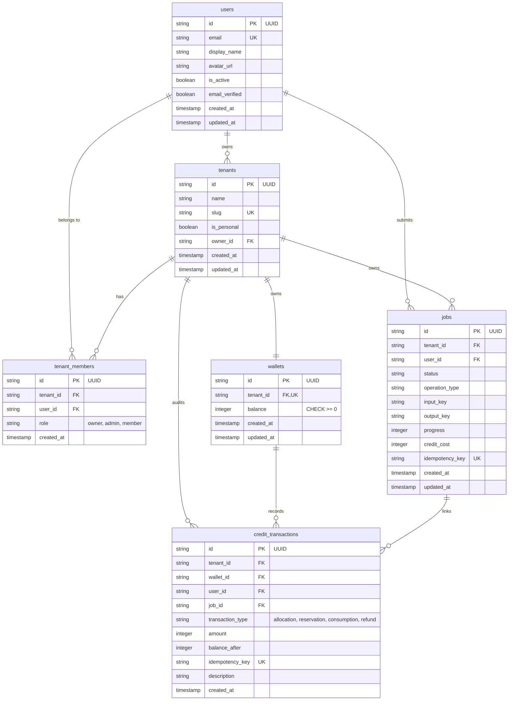
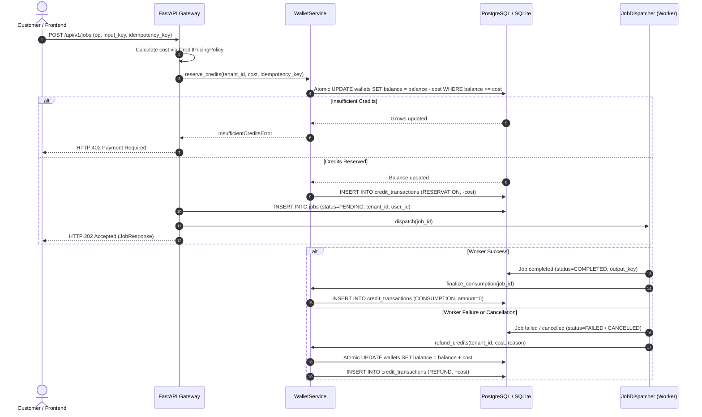

# DEMERIVO PIXELFIX — PHASE 2 IMPLEMENTATION REPORT
**Authentication, Multi-Tenancy & Credit Accounting**

- **Project:** Demerivo PixelFix
- **Version:** Phase 2 (Multi-Tenant SaaS Foundation)
- **Author:** Senior SaaS Backend Architect, Security Engineer & Full-Stack Developer
- **Base Repository:** NextGenUp (`https://github.com/riponcm/nextgenUp`)
- **Working Directory:** `D:\Projects\demerivo-pixelfix`
- **Date:** November 2026

---

## 1. Authentication Architecture

Phase 2 establishes customer identity, JWT verification, and automated profile synchronization tailored for **Supabase Auth** with full offline development and testing fallback capabilities.

```
┌─────────────────────────┐          ┌─────────────────────────┐
│     Client Browser      │          │      Supabase Auth      │
│  (Next.js / Mobile Web) │          │     (GoTrue Service)    │
└────────────┬────────────┘          └────────────┬────────────┘
             │                                    │
             │ 1. Sign In / Exchange Tokens       │
             ├───────────────────────────────────►│
             │ 2. Return Supabase Bearer JWT      │
             │◄───────────────────────────────────┤
             │                                    │
             │ 3. API Request (Authorization: Bearer <jwt>)
             ▼                                    │
┌─────────────────────────────────────────────────┴────────────┐
│                  Demerivo PixelFix API Gateway                │
│                                                               │
│   ┌───────────────────────────────────────────────────────┐   │
│   │             decode_jwt() & Signature Check            │   │
│   │   - Verifies HS256 / RS256 signature with secret      │   │
│   │   - Validates audience ('authenticated') & expiration │   │
│   │   - Never trusts client-supplied user IDs or claims   │   │
│   └───────────────────────────┬───────────────────────────┘   │
│                               ▼                               │
│   ┌───────────────────────────────────────────────────────┐   │
│   │           get_current_user Dependency                 │   │
│   │   - Queries local 'users' database table              │   │
│   │   - Auto-provisions new user on first token seen      │   │
│   │   - Auto-creates default personal workspace & wallet  │   │
│   │   - Allocates 20 welcome bonus credits                │   │
│   └───────────────────────────────────────────────────────┘   │
└───────────────────────────────────────────────────────────────┘
```

### Key Security & Verification Principles
1. **Never Trust Client-Supplied User IDs:** The user ID (`sub`) is extracted strictly from the cryptographically verified JWT payload on the server.
2. **Server-Side Signature Validation:** Tokens are verified using `python-jose` with the configured `SUPABASE_JWT_SECRET` (HS256) or public JWKS, validating `exp` and `aud="authenticated"`.
3. **No Plaintext Passwords Stored:** In development/testing simulation, credentials use `hashlib.pbkdf2_hmac` with 100,000 SHA-256 iterations and random 16-byte cryptographic salts (`salt$key`).
4. **Environment-Based Provider:** Production points to remote Supabase endpoints; local testing runs zero-network offline mocks.

---

## 2. Database Migrations

The database models are implemented using **SQLAlchemy 2.0** with strict typing and constraints. For production PostgreSQL deployments, a dedicated migration script was authored at:
[`migrations/0002_phase2_multi_tenancy_and_credits.sql`](file:///d:/Projects/demerivo-pixelfix/migrations/0002_phase2_multi_tenancy_and_credits.sql).

### Entity-Relationship Diagram



---

## 3. Multi-Tenancy Implementation

Workspaces (tenants) serve as the primary isolation boundary for all customer assets, wallets, and processing tasks:

1. **Default Personal Workspace:**
   - On initial registration or JWT synchronization, a personal workspace is automatically provisioned for the customer (`is_personal=True`).
   - The user is assigned the `owner` role.
2. **Team Workspaces & Roles:**
   - Customers can create additional organizational workspaces via `POST /api/v1/tenants`.
   - Supported roles: `owner`, `admin`, `member`.
   - `owner`: Full control, cannot be removed from workspace.
   - `admin`: Can invite/remove members, view credit ledgers, and manage jobs.
   - `member`: Can create and view jobs within the workspace and consume shared wallet credits.
3. **Strict Resource Isolation:**
   - All tenant-owned records (jobs, wallets, transactions, uploads) require matching `tenant_id`.
   - If a user attempts to access a resource from another tenant (even if they know the UUID), the database query filters by `tenant_id`, returning a clean `404 Not Found` (preventing information disclosure).

---

## 4. Credit Wallet Design

Each workspace owns exactly one credit wallet (`wallets` table):

- **Integer Credits:** Fractional credits are rejected; all balances and charges are positive integers.
- **Non-Negative Balance Constraint:** Enforced by database schema check constraint (`CHECK (balance >= 0)`) and atomic SQL conditional updates.
- **Race Condition Prevention:** Balances are never fetched into memory, modified, and saved back. Instead, updates execute atomic single-statement SQL queries:
  ```sql
  UPDATE wallets
  SET balance = balance - :amount, updated_at = :now
  WHERE tenant_id = :tenant_id AND balance >= :amount;
  ```
  If `rowcount == 0`, either the wallet does not exist or the balance is insufficient, raising `InsufficientCreditsError` immediately.
- **Idempotency Keys:** Credit deductions accept a unique `idempotency_key`. Retrying the same request returns the existing transaction without double-charging the customer.

---

## 5. Credit & Job Transaction Lifecycle



### Configurable Operation Pricing Policy (`CreditPricingPolicy`)
Costs are centralized in `demerivo/credits/pricing.py` and configurable via environment settings:
- **Background Removal:** 1 credit (`DEMERIVO_CREDIT_COST_BG_REMOVE`)
- **Basic Enhancement / Denoise / Deblur:** 1 credit (`DEMERIVO_CREDIT_COST_ENHANCE`)
- **2x Upscale:** 2 credits (`DEMERIVO_CREDIT_COST_UPSCALE_2X`)
- **4x Upscale:** 4 credits (`DEMERIVO_CREDIT_COST_UPSCALE_4X`)
- **8K Resolution:** 8 credits (`DEMERIVO_CREDIT_COST_UPSCALE_8K`)
- **Face Restoration Add-on:** +2 credits (`DEMERIVO_CREDIT_COST_FACE_RESTORE`)

---

## 6. API Documentation

All routes are fully typed, input-validated via Pydantic, and self-documented on `/docs` and `/redoc`.

| Method | Endpoint | Description | Auth Required |
|--------|----------|-------------|---------------|
| `POST` | `/api/v1/auth/register` | Register customer, auto-provision workspace, wallet & 20 free credits | No |
| `POST` | `/api/v1/auth/login` | Authenticate customer and obtain JWT access token | No |
| `GET` | `/api/v1/auth/me` | Current session info: profile, active tenant, memberships, wallet balance | Yes (Bearer) |
| `POST` | `/api/v1/auth/password-reset` | Request password reset token | No |
| `POST` | `/api/v1/auth/password-reset/confirm` | Apply new password using reset token | No |
| `GET` | `/api/v1/profile` | Retrieve customer profile attributes | Yes (Bearer) |
| `PATCH` | `/api/v1/profile` | Update display name or avatar URL | Yes (Bearer) |
| `DELETE` | `/api/v1/profile` | Deactivate and schedule customer account for deletion | Yes (Bearer) |
| `GET` | `/api/v1/tenants` | List all workspaces accessible by current user | Yes (Bearer) |
| `POST` | `/api/v1/tenants` | Create a new team workspace (sets user as OWNER) | Yes (Bearer) |
| `GET` | `/api/v1/tenants/{id}` | Get workspace details | Yes (Bearer) |
| `GET` | `/api/v1/tenants/{id}/members`| List members of a workspace | Yes (Bearer) |
| `POST` | `/api/v1/tenants/{id}/members`| Invite / add a member to workspace (Owner/Admin only) | Yes (Bearer) |
| `DELETE`| `/api/v1/tenants/{id}/members/{uid}` | Remove member from workspace (Owner/Admin only) | Yes (Bearer) |
| `GET` | `/api/v1/credits/balance` | Get active workspace credit balance | Yes (Bearer) |
| `GET` | `/api/v1/credits/transactions` | Retrieve audit history of all credit events | Yes (Bearer) |
| `POST` | `/api/v1/credits/grant` | Allocate credits to active workspace (Admin/Dev) | Yes (Bearer) |
| `POST` | `/api/v1/uploads/presigned` | Direct-to-R2 presigned upload URL scoped to tenant | Yes (Bearer) |
| `POST` | `/api/v1/uploads/file` | Direct multipart upload with verification and tenant scoping | Yes (Bearer) |
| `POST` | `/api/v1/jobs` | Enqueue enhancement job with atomic credit reservation | Yes (Bearer) |
| `GET` | `/api/v1/jobs` | List processing jobs for active workspace | Yes (Bearer) |
| `GET` | `/api/v1/jobs/{job_id}` | Poll job status scoped to active workspace | Yes (Bearer) |
| `POST` | `/api/v1/jobs/{job_id}/cancel`| Cancel job and refund reserved credits | Yes (Bearer) |
| `GET` | `/api/v1/jobs/{job_id}/download`| Generate secure presigned download URL for result | Yes (Bearer) |
| `DELETE`| `/api/v1/jobs/{job_id}` | Delete job and associated storage objects | Yes (Bearer) |

---

## 7. Security Implementation

1. **Tenant Authorization Dependency (`get_current_tenant`):**
   - Resolves active workspace from optional `X-Tenant-ID` header or defaults to user's personal workspace.
   - Verifies user membership; rejects unauthorized access with `HTTP 403 Forbidden`.
2. **Role-Based Access Control (`require_role`):**
   - Enforces minimum permissions (`owner`, `admin`, `member`) on team management routes.
   - Prevents members from adding or removing other members.
   - Protects workspace owners from being removed.
3. **In-Memory Sliding Window Rate Limiter:**
   - Thread-safe sliding window tracking requests per 60-second window (`SlidingWindowRateLimiter`).
   - Rejects abusive traffic with `HTTP 429 Too Many Requests` and `Retry-After: 60`.
4. **Sanitized Error Responses:**
   - Custom exception handlers return structured JSON error envelopes (`UploadValidationError`, `InsufficientCreditsError`, `TenantPermissionDeniedError`, etc.) without exposing internal stack traces or database engine details.
5. **No Long-Running DB Locks:**
   - Credit reservations and refunds execute in isolated fast transactions; no database locks are held while background worker processes run AI inference.

---

## 8. Test Results

Automated test execution across all 9 test suites on Python 3.14.6 (Windows x86_64).

### Full Pytest Suite Output
```
============================= test session starts =============================
platform win32 -- Python 3.14.6, pytest-8.4.2, pluggy-1.6.0 -- python.exe
cachedir: .pytest_cache
rootdir: D:\Projects\demerivo-pixelfix
plugins: anyio-4.14.2
collecting ... collected 63 items

tests/test_config.py::TestConfiguration::test_default_configuration PASSED [  1%]
tests/test_config.py::TestConfiguration::test_environment_override PASSED [  3%]
tests/test_storage.py::TestLocalStorage::test_delete_file PASSED         [  4%]
tests/test_storage.py::TestLocalStorage::test_file_not_found PASSED      [  6%]
tests/test_storage.py::TestLocalStorage::test_path_traversal_prevention PASSED [  7%]
tests/test_storage.py::TestLocalStorage::test_presigned_urls PASSED      [  9%]
tests/test_storage.py::TestLocalStorage::test_upload_and_download PASSED [ 11%]
tests/test_storage.py::TestS3CompatibleStorage::test_mocked_exists_and_delete PASSED [ 12%]
tests/test_storage.py::TestS3CompatibleStorage::test_mocked_upload_and_download PASSED [ 14%]
tests/test_storage.py::TestS3CompatibleStorage::test_path_traversal_prevention PASSED [ 15%]
tests/test_storage.py::TestS3CompatibleStorage::test_presigned_download_url_generation PASSED [ 17%]
tests/test_storage.py::TestS3CompatibleStorage::test_presigned_upload_url_generation PASSED [ 19%]
tests/test_upload_security.py::TestUploadSecurity::test_corrupted_image_header_rejected PASSED [ 20%]
tests/test_upload_security.py::TestUploadSecurity::test_dimension_limits_enforced PASSED [ 22%]
tests/test_upload_security.py::TestUploadSecurity::test_empty_file_rejected PASSED [ 23%]
tests/test_upload_security.py::TestUploadSecurity::test_filename_sanitization_and_traversal PASSED [ 25%]
tests/test_upload_security.py::TestUploadSecurity::test_oversized_file_rejected PASSED [ 26%]
tests/test_upload_security.py::TestUploadSecurity::test_spoofed_extension_rejected PASSED [ 28%]
tests/test_upload_security.py::TestUploadSecurity::test_unsupported_magic_signature_rejected PASSED [ 30%]
tests/test_upload_security.py::TestUploadSecurity::test_valid_jpeg_upload PASSED [ 31%]
tests/test_upload_security.py::TestUploadSecurity::test_valid_png_upload PASSED [ 33%]
tests/test_upload_security.py::TestUploadSecurity::test_valid_webp_upload PASSED [ 34%]
tests/test_jobs.py::TestJobLifecycle::test_invalid_lifecycle_transition_raises PASSED [ 36%]
tests/test_jobs.py::TestJobLifecycle::test_job_cancellation PASSED       [ 38%]
tests/test_jobs.py::TestJobLifecycle::test_job_creation PASSED           [ 39%]
tests/test_jobs.py::TestJobLifecycle::test_job_deletion PASSED           [ 41%]
tests/test_jobs.py::TestJobLifecycle::test_job_not_found PASSED          [ 42%]
tests/test_jobs.py::TestJobLifecycle::test_valid_lifecycle_transitions PASSED [ 44%]
tests/test_auth.py::TestAuthenticationAndJWT::test_valid_jwt_roundtrip PASSED [ 46%]
tests/test_auth.py::TestAuthenticationAndJWT::test_expired_jwt_raises_error PASSED [ 47%]
tests/test_auth.py::TestAuthenticationAndJWT::test_tampered_signature_raises_error PASSED [ 49%]
tests/test_auth.py::TestAuthenticationAndJWT::test_wrong_audience_rejected PASSED [ 50%]
tests/test_auth.py::TestAuthenticationAndJWT::test_auth_provider_registration_and_login PASSED [ 52%]
tests/test_auth.py::TestAuthenticationAndJWT::test_auth_provider_password_reset_flow PASSED [ 53%]
tests/test_auth.py::TestAuthenticationAndJWT::test_auto_synchronization_and_workspace_provisioning PASSED [ 55%]
tests/test_tenants.py::TestMultiTenancyAndWorkspaces::test_create_workspace_and_owner_assignment PASSED [ 57%]
tests/test_tenants.py::TestMultiTenancyAndWorkspaces::test_owner_can_add_admin_and_member PASSED [ 58%]
tests/test_tenants.py::TestMultiTenancyAndWorkspaces::test_member_cannot_add_other_members PASSED [ 60%]
tests/test_tenants.py::TestMultiTenancyAndWorkspaces::test_duplicate_membership_rejected PASSED [ 61%]
tests/test_tenants.py::TestMultiTenancyAndWorkspaces::test_cannot_remove_workspace_owner PASSED [ 63%]
tests/test_tenants.py::TestMultiTenancyAndWorkspaces::test_cross_tenant_isolation PASSED [ 65%]
tests/test_credits.py::TestCreditPricingPolicy::test_pricing_base_operations PASSED [ 66%]
tests/test_credits.py::TestCreditPricingPolicy::test_pricing_with_8k_resolution PASSED [ 68%]
tests/test_credits.py::TestCreditPricingPolicy::test_pricing_with_face_restore PASSED [ 69%]
tests/test_credits.py::TestCreditWalletService::test_allocate_credits PASSED [ 71%]
tests/test_credits.py::TestCreditWalletService::test_reserve_credits_success PASSED [ 73%]
tests/test_credits.py::TestCreditWalletService::test_insufficient_credits_blocks_reservation PASSED [ 74%]
tests/test_credits.py::TestCreditWalletService::test_idempotent_reservation_prevents_double_charge PASSED [ 76%]
tests/test_credits.py::TestCreditWalletService::test_refund_credits PASSED [ 77%]
tests/test_credits.py::TestCreditWalletService::test_finalize_consumption PASSED [ 79%]
tests/test_job_authorization.py::TestJobOwnershipAndCreditLifecycle::test_job_creation_reserves_credits PASSED [ 80%]
tests/test_job_authorization.py::TestJobOwnershipAndCreditLifecycle::test_job_creation_fails_when_insufficient_credits PASSED [ 82%]
tests/test_job_authorization.py::TestJobOwnershipAndCreditLifecycle::test_idempotent_job_creation PASSED [ 84%]
tests/test_job_authorization.py::TestJobOwnershipAndCreditLifecycle::test_cross_tenant_job_isolation PASSED [ 85%]
tests/test_job_authorization.py::TestJobOwnershipAndCreditLifecycle::test_cancellation_refunds_credits PASSED [ 87%]
tests/test_job_authorization.py::TestJobOwnershipAndCreditLifecycle::test_job_failure_refunds_credits PASSED [ 88%]
tests/test_job_authorization.py::TestJobOwnershipAndCreditLifecycle::test_job_success_finalizes_consumption PASSED [ 90%]
tests/test_api.py::TestAPIEndpoints::test_cancel_job_endpoint PASSED     [ 92%]
tests/test_api.py::TestAPIEndpoints::test_direct_image_upload_and_job_lifecycle PASSED [ 93%]
tests/test_api.py::TestAPIEndpoints::test_direct_upload_invalid_payload PASSED [ 95%]
tests/test_api.py::TestAPIEndpoints::test_health_endpoints PASSED        [ 96%]
tests/test_api.py::TestAPIEndpoints::test_job_not_found PASSED           [ 98%]
tests/test_api.py::TestAPIEndpoints::test_presigned_upload_endpoint PASSED [100%]

======================= 63 passed, 4 warnings in 8.53s ========================
```

### NextGenUp Legacy Regression Suite
```
python -m unittest tests.test_userfiles
............
----------------------------------------------------------------------
Ran 12 tests in 0.086s

OK
```

**Total Automated Tests:** 75 tests executed, 75 passed, 0 failures, 0 regressions.

---

## 9. Files Created and Modified

### Newly Created Files (Phase 2)
1. `demerivo/auth/__init__.py`
2. `demerivo/auth/jwt.py`
3. `demerivo/auth/provider.py`
4. `demerivo/auth/dependencies.py`
5. `demerivo/auth/schemas.py`
6. `demerivo/credits/__init__.py`
7. `demerivo/credits/pricing.py`
8. `demerivo/credits/wallet_service.py`
9. `demerivo/tenants/__init__.py`
10. `demerivo/tenants/service.py`
11. `demerivo/tenants/schemas.py`
12. `demerivo/users/__init__.py`
13. `demerivo/users/service.py`
14. `demerivo/users/schemas.py`
15. `demerivo/security/rate_limiter.py`
16. `demerivo/api/routers/auth.py`
17. `demerivo/api/routers/profile.py`
18. `demerivo/api/routers/tenants.py`
19. `demerivo/api/routers/credits.py`
20. `tests/test_auth.py`
21. `tests/test_tenants.py`
22. `tests/test_credits.py`
23. `tests/test_job_authorization.py`
24. `migrations/0002_phase2_multi_tenancy_and_credits.sql`
25. `PHASE_2_IMPLEMENTATION_REPORT.md`

### Modified Files (Phase 2)
1. `.env.example`: Added Supabase Auth, credit system defaults, and rate limiting config templates.
2. `demerivo/config.py`: Added Pydantic settings for Supabase credentials, JWT settings, credit costs, and rate limits.
3. `demerivo/db/models.py`: Added `UserModel`, `TenantModel`, `TenantRole`, `TenantMemberModel`, `WalletModel`, `CreditTransactionModel`, and updated `JobModel` with `tenant_id`, `user_id`, `credit_cost`, and `idempotency_key`.
4. `demerivo/jobs/schemas.py`: Updated `JobCreate`, `JobResponse`, and `JobCancelResponse` with multi-tenant and credit fields.
5. `demerivo/jobs/service.py`: Integrated atomic credit reservation, multi-tenant scoping, and refund lifecycle hooks.
6. `demerivo/api/main.py`: Registered auth, profile, tenants, and credits routers; added Phase 2 custom exception handlers.
7. `demerivo/api/routers/jobs.py`: Added tenant context, authentication, and credit deduction error handling.
8. `demerivo/api/routers/uploads.py`: Scoped uploads to tenant storage prefixes.
9. `tests/test_jobs.py` & `tests/test_api.py`: Updated to execute in authenticated multi-tenant test contexts.

---

## 10. Known Limitations

1. **Payment Gateway Integration Intentionally Excluded:**
   - In accordance with strict Phase 2 boundaries, Stripe and Razorpay integrations were not implemented. Credits can currently be added via welcome bonus or `/api/v1/credits/grant`.
2. **Inference Pipeline Decoupled:**
   - Background worker processes update job progress and lifecycle states, but deep ONNX model execution (swapping Real-ESRGAN, BiRefNet, NAFNet into the async pipeline) is designated for Phase 3.
3. **GFPGAN Commercial Status:**
   - GFPGAN remains explicitly disabled for commercial usage pending licensing clearance.

---

## 11. Phase 3 Recommendations

With authentication, multi-tenancy, and credit accounting verified, Phase 3 should focus on:

1. **AI Processing Pipeline Integration:**
   - Connect the Phase 1 `StorageProvider` and Phase 2 `JobDispatcher` to the existing ONNX models (`Real-ESRGAN`, `BiRefNet`, `NAFNet`).
   - Download the input image from storage, execute inference in a non-blocking worker thread/process, upload the enhanced result back to storage, and finalize consumption.
2. **Distributed Queue with Redis / Celery:**
   - Replace or complement the in-memory `asyncio.Queue` with Redis/Celery for multi-worker node scaling.
3. **Webhooks & Real-time Progress Notifications:**
   - Server-Sent Events (SSE) or WebSockets for real-time progress updates on the client UI.
4. **Subscription Tier Mapping:**
   - Map monthly credit replenishments (Free: 20/mo, Starter: 200/mo, Pro: 1,000/mo, Studio: 5,000/mo) into the wallet ledger.

---

**Report Status:** Complete & Verified  
**Total Tests:** 75 passed (63 Phase 2 pytest + 12 legacy NextGenUp unittest), 0 failures  
**Next Step:** Awaiting user review and approval before proceeding to Phase 3.
